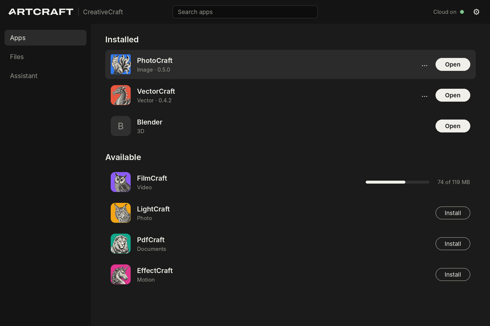
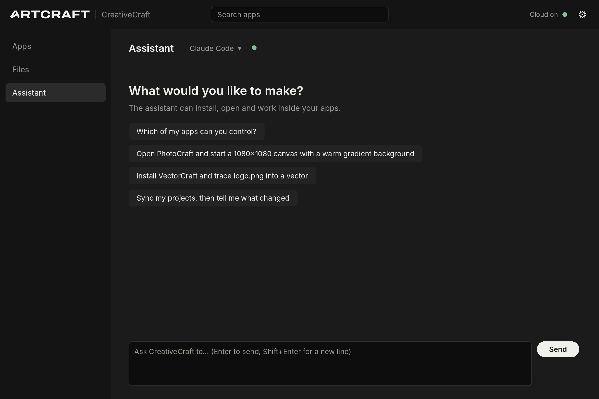

# CreativeCraft

**One home for open-source creative apps.** CreativeCraft installs and updates the seven Craft apps
(PhotoCraft, VectorCraft, FilmCraft, LightCraft, PdfCraft, EffectCraft, DesignCraft), finds and
launches other open-source tools you already use (Blender, Krita, Inkscape, GIMP, Kdenlive,
darktable, Godot, ComfyUI), keeps your project files in sync through Google Drive or any synced
folder, and has a built-in **AI chat** that drives every agent-ready app through MCP, powered by
the agent CLI you already use: Claude Code, OpenCode, Hermes Agent, Antigravity CLI, or your own.

Pure Rust, built the same way as the Craft apps: a layered Cargo workspace, a native egui/eframe
window on wgpu (no Electron, Tauri or webview), a headless CLI, and every action going through one
command registry, so anything you can click, an agent can do.

<p> </p>

> Previews are rendered from the UI's layout and colours by `docs/preview/render.py`; the real
> window is drawn by egui and differs in font rendering details.

> **Pitch build:** shows the ArtCraft logo and the Craft app icons for a presentation to the
> ArtCraft Team. See [NOTICE](NOTICE) before distributing.

> Status: **pre-alpha scaffold.** Architecture, sync engine, installer, Drive backend and MCP hub
> are in place with tests; see [ROADMAP.md](ROADMAP.md) for what's next.

## Build and run

Rust 1.95+ (edition 2024).

```sh
cargo build --release
./target/release/creativecraft          # the hub window
./target/release/creativecraft-cli list # or the CLI
./target/release/creativecraft-cli chat "which of my apps can you control?"
cargo test                              # all tests
```

Linux builds need the usual windowing dev packages for eframe (Wayland/X11, xkbcommon).

## What's in the box

| Feature | How it works |
|---|---|
| **Install & update apps** | Downloads each Craft app's portable archive straight from its own GitHub releases, verifies SHA-256 when published, unpacks per-user (no admin rights). Updates install side by side and only replace the old version once the new one works. |
| **Other open-source apps** | Detected on `PATH`, in `/Applications`, or under Program Files; "Get it" opens the official download page. CreativeCraft never redistributes them. |
| **Cloud saves** | A projects folder synced with **Google Drive** (REST API, `drive.file` scope: CreativeCraft can only see files it created) or **any folder** your sync client mirrors (Drive for desktop, Dropbox, OneDrive, Nextcloud…). Three-way sync: conflicting edits are never overwritten; the other version is saved alongside as `name (cloud copy for <computer>).ext`. Deletions go to the trash. |
| **AI chat** | A chat page (and `creativecraft-cli chat`) that runs your chosen agent CLI headless, one turn per message, resuming its own session, with the hub as its only MCP server. No API keys in CreativeCraft: the agent uses its own account and model. See [docs/ai-chat.md](docs/ai-chat.md). |
| **MCP hub** | `creativecraft-cli mcp` is an MCP server (stdio). It exposes hub tools (`hub_list_apps`, `hub_install_app`, `hub_launch_app`, `hub_sync_projects`) and starts each app's own `<app>-cli mcp` on demand, re-exporting its tools as `<app>__<tool>`. Add your own MCP servers (e.g. a Blender add-on bridge) on the Connections page. |

### Set up the AI chat

1. Install one agent CLI and sign in to it once in a terminal (`claude`, `opencode`, `hermes` or `agy`).
2. In CreativeCraft open **AI chat**, pick it from the menu. Hermes needs one click on **Set up**.
3. Ask away. Settings → AI chat has the model, a custom program path, and the "use all tools
   without asking" switch (off by default).

### Connect another assistant

The chat wires this up for you; for any other MCP host, point it at the CLI (the Connections page
shows the exact path and a Copy button):

```json
{ "mcpServers": { "creativecraft": { "command": "/path/to/creativecraft-cli", "args": ["mcp"] } } }
```

### Set up Google Drive

Drive needs an OAuth client that **you, the publisher,** own:

1. In Google Cloud Console, create a project, enable the **Google Drive API**.
2. Configure the OAuth consent screen; add the scope `.../auth/drive.file` only.
3. Create credentials → **OAuth client ID** → application type **Desktop app**.
4. Put the id and secret in Settings → Cloud saves → Google Drive (or set
   `CREATIVECRAFT_GOOGLE_CLIENT_ID` / `CREATIVECRAFT_GOOGLE_CLIENT_SECRET` at build/packaging time), then
   Projects → **Sign in to Google Drive**. Sign-in uses your browser and a loopback redirect
   with PKCE; no embedded webview.

For a public release, Google must verify the consent screen; `drive.file` is a non-sensitive
scope, which keeps that review light.

## Layout

```text
crates/
  platform     L0  host OS/arch, release-asset matching, version compare   (std only)
  sync-plan    L0  three-way sync planner: pure, deterministic             (std only)
  catalog      L1  app catalog model; built-in catalog/apps.toml + user overlay
  install      L2  GitHub releases, download + verify, unpack, detect, launch
  cloud        L2  CloudStore trait, Google Drive + folder backends, sync executor
  mcp          L2  MCP stdio client, hub MCP server
  agent        L2  AI chat: agent-CLI backends, MCP wiring, stream parsing, transcript
  engine       L3  Session + command registry (UI, CLI and agent all call this)
  ui-egui      L4  the window (thin)
apps/
  creativecraft          desktop app (eframe/wgpu)
  creativecraft-cli      headless CLI, incl. `chat` and `mcp`
catalog/apps.toml  which apps exist and where they come from
```

See [docs/architecture.md](docs/architecture.md) and, before contributing, [AGENTS.md](AGENTS.md)
and [docs/clean-room.md](docs/clean-room.md).

## License

MIT OR Apache-2.0, like the Craft apps. See [NOTICE](NOTICE) for trademarks and affiliation.
