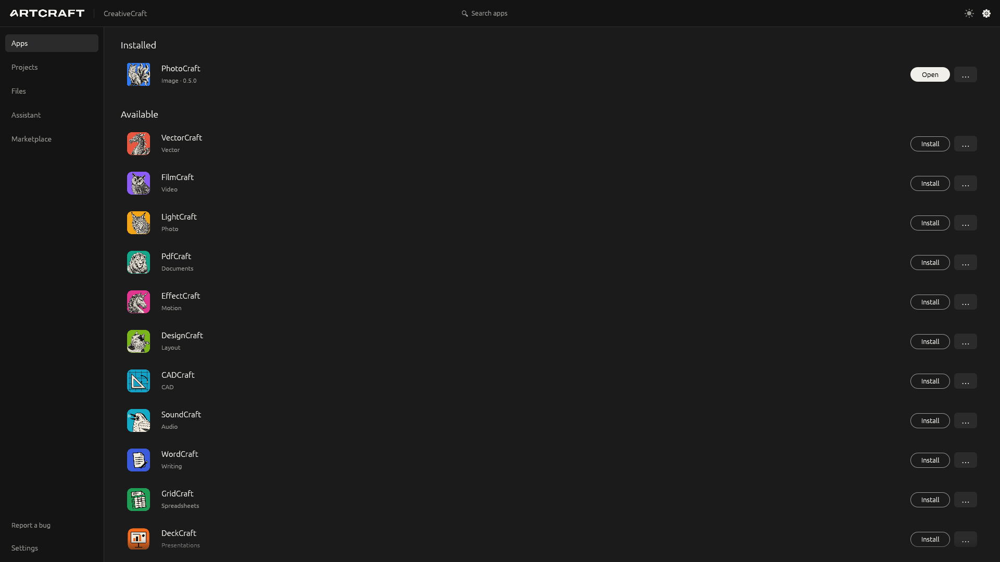
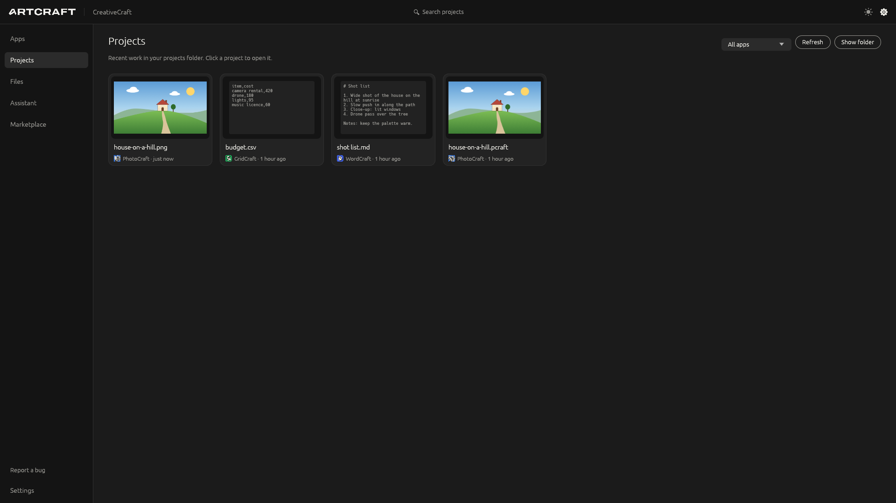
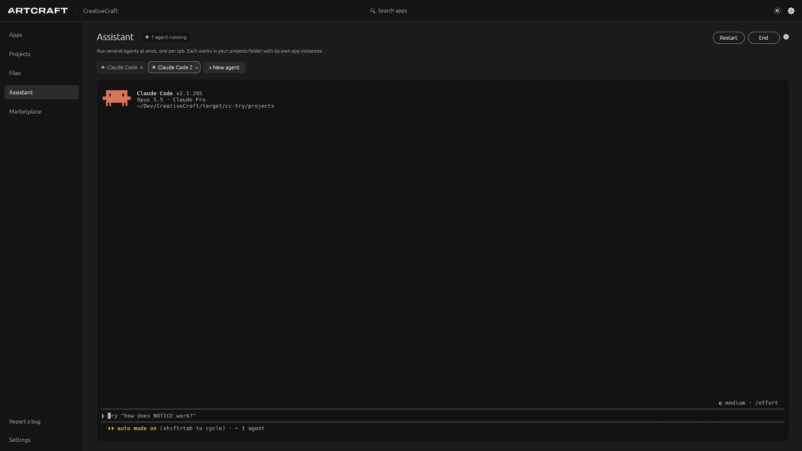
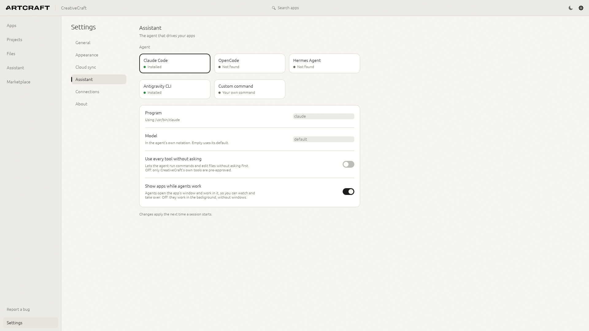
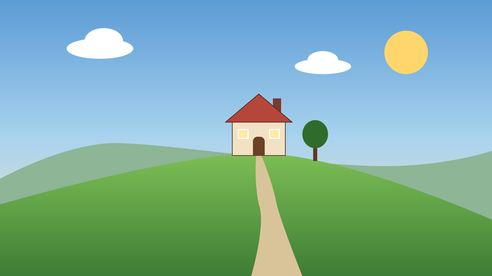

# CreativeCraft

**One home for open-source creative apps.** CreativeCraft installs and updates the twelve Craft apps
(PhotoCraft, VectorCraft, FilmCraft, LightCraft, PdfCraft, EffectCraft, DesignCraft, CADCraft,
SoundCraft, WordCraft, GridCraft, DeckCraft) and SolveCraft, a community 3D CAD app built the
same way, finds and
launches other open-source tools you already use (Blender, Krita, Inkscape, GIMP, Kdenlive,
darktable, Godot, LibreOffice, ComfyUI), keeps your project files in sync through Google Drive or any synced
folder, and has a built-in **AI assistant** that drives every agent-ready app through MCP, powered by
the agent CLI you already use: Claude Code, OpenCode, Hermes Agent, Antigravity CLI, or your own.

Pure Rust, built the same way as the Craft apps: a layered Cargo workspace, a native egui/eframe
window on wgpu (no Electron, Tauri or webview), a headless CLI, and every action going through one
command registry, so anything you can click, an agent can do.

<p></p>

<p>



</p>

<p><br>
<sub>Made by an agent in PhotoCraft from one sentence: "make a picture of a house on a hill".</sub></p>

## Install

| Platform | How |
|---|---|
| **Arch Linux** | From the AUR: [`creativecraft-bin`](https://aur.archlinux.org/packages/creativecraft-bin), e.g. `yay -S creativecraft-bin` or `paru -S creativecraft-bin` |
| **Linux (any distro)** | Download `creativecraft-<version>-linux-<arch>.flatpak` from [Releases](https://github.com/bhimio1/CreativeCraft/releases) and run `flatpak install --user creativecraft-*.flatpak` (it pulls the Freedesktop runtime from Flathub) |
| **Linux, macOS, Windows** | Portable archives (`.tar.gz`, `.zip`) on [Releases](https://github.com/bhimio1/CreativeCraft/releases), checked against `SHA256SUMS` |

Releases are pre-releases for now (pre-alpha).

> **Pitch build:** shows the ArtCraft logo and the Craft app icons for a presentation to the
> ArtCraft Team. See [NOTICE](NOTICE) before distributing.

> Status: **pre-alpha scaffold.** Architecture, sync engine, installer, Drive backend and MCP hub
> are in place with tests; see [ROADMAP.md](ROADMAP.md) for what's next.

## Build and run

Rust 1.95+ (edition 2024).

```sh
cargo build --release
./target/release/creativecraft          # the hub window
./target/release/creativecraft-cli list # or the CLI
./target/release/creativecraft-cli chat "which of my apps can you control?"
cargo test                              # all tests
```

Linux builds need the usual windowing dev packages for eframe (Wayland/X11, xkbcommon).

## What's in the box

| Feature | How it works |
|---|---|
| **Install & update apps** | Downloads each Craft app's portable archive straight from its own GitHub releases, verifies SHA-256 when published, unpacks per-user (no admin rights). Updates install side by side and only replace the old version once the new one works. |
| **Forks and git builds** | Each Craft app can instead install from a fork's releases, or be built from git (the official repository or any fork, any branch) with your own `git` and `cargo`: **… → Install source** in Apps, or `creativecraft-cli install <app> --fork owner/name` / `--git [url] [--branch b]`. Updates fetch and rebuild only what changed. |
| **Other open-source apps** | Detected on `PATH`, in `/Applications`, or under Program Files; "Get it" opens the official download page. Once installed they show the icon their own installation provides (desktop entry on Linux, bundle on macOS). CreativeCraft never redistributes them or their artwork. |
| **Projects** | A grid of recent files in the projects folder with previews taken from the files themselves (embedded thumbnails in ZIP-based documents such as `.pcraft`, OpenDocument and Office files, `.blend` thumbnails, the first page of PDFs, images, the first lines of text files), each opening in the app that made it. |
| **Cloud sync** | Keep the projects folder in sync with **Google Drive**, any **WebDAV** server (Nextcloud, ownCloud, Synology, QNAP, TrueNAS, pCloud…), **S3-compatible storage** (AWS, Backblaze B2, Cloudflare R2, Wasabi, MinIO), anything your own **rclone** reaches (Dropbox, OneDrive, Box, SFTP, SMB…), or **any folder** (a synced folder or a mounted NAS share). Three-way sync never overwrites: conflicting edits are kept side by side, deletions go to a trash, downloads are checksum-checked before they replace anything. `.creativecraftignore` for files not to sync. See [docs/cloud-sync.md](docs/cloud-sync.md). |
| **AI assistant** | The Assistant page runs agents in tabs: each tab is a terminal with an agent CLI's own interactive UI (any mix of Claude Code, OpenCode, Hermes, Antigravity or your own) in the projects folder, with the hub as an MCP server, so several agents can work on different tasks at once. `creativecraft-cli chat` runs one headless turn instead. No API keys in CreativeCraft: the agent uses its own account and model. See [docs/ai-chat.md](docs/ai-chat.md). |
| **Stock media** | Free public-domain and CC0 photos, art, video, audio and more from museums, NASA and open archives, through [StockCraft](https://github.com/bhimio1/stockcraft): search, preview with rights and credit line, download into the projects folder. Agents can search and download too. See [docs/stock.md](docs/stock.md). |
| **AI generation** | The Generate page makes images and short videos from a description with the service you choose: **ComfyUI** or **Stable Diffusion WebUI** on your own computer (free, private), or your own API key for **OpenAI**, **Google Gemini/Veo**, **xAI**, **Together**, and **Replicate** or **fal** (hundreds of models: FLUX, Ideogram, Recraft, Seedream, Kling, Luma, MiniMax, Wan…), or any **OpenAI-compatible endpoint**. Start from a picture to edit, restyle or animate it, or paint over just the part to change. Results land in `Generated/` in the projects folder with a note of how they were made. Keys stay in a file only you can read. Agents can generate through the hub's tools. You can turn that off. See [docs/generation.md](docs/generation.md). |
| **Marketplace** | Plugins that give agents tools for more apps: Blender, Godot and Inkscape to start. Each is an MCP server run from its publisher's own package; installing shows exactly what will run first. See [docs/marketplace.md](docs/marketplace.md). |
| **MCP hub** | `creativecraft-cli mcp` is an MCP server (stdio). It exposes hub tools (`hub_list_apps`, `hub_install_app`, `hub_launch_app`, `hub_sync_projects`) and starts each app's own `<app>-cli mcp` on demand, re-exporting its tools as `<app>__<tool>`. Agents work in the app's visible window by default (the desktop app's control channel), so you can watch and take over, and can open more independent instances, each its own window (`app_open_instance` → `photocraft-2__<tool>`, …). Files they save go to the projects folder. |

### Set up the assistant

1. Install one agent CLI and sign in to it once in a terminal (`claude`, `opencode`, `hermes` or `agy`).
2. In CreativeCraft open **Assistant** and pick it from the menu; it starts right there. Hermes
   needs one click on **Set up**.
3. Type to it as you would in any terminal. Settings → Assistant has the model, a custom program
   path, and the "use every tool without asking" switch (off by default).

### Connect another assistant

The Assistant wires this up for you; for any other MCP host, point it at the CLI (the Connections page
shows the exact path and a Copy button):

```json
{ "mcpServers": { "creativecraft": { "command": "/path/to/creativecraft-cli", "args": ["mcp"] } } }
```

### Set up Google Drive

Drive sync needs a free Google Cloud OAuth client (about ten minutes, once): enable the **Google
Drive API**, set up the consent screen with only the `drive.file` scope, create a **Desktop app**
client, and paste its ID and secret into **Settings → Cloud sync → Google Drive**, then **Sign
in**. [docs/google-drive.md](docs/google-drive.md) walks through every step, explains how sync
keeps your work safe, and covers the common errors.

No Google Cloud account? Choose **A folder** instead and point it at the folder Google Drive for
desktop (or any other sync app) already syncs.

## Layout

```text
crates/
  platform     L0  host OS/arch, release-asset matching, version compare   (std only)
  sync-plan    L0  three-way sync planner: pure, deterministic             (std only)
  catalog      L1  app catalog model; built-in catalog/apps.toml + user overlay
  marketplace  L1  plugin index model; built-in marketplace/plugins.toml (+ fetched update)
  secrets      L1  passwords, keys and tokens: the OS keychain, else a private file
  install      L2  GitHub releases, download + verify, unpack, detect, launch
  cloud        L2  CloudStore trait; Drive, WebDAV, S3, rclone, folder backends; sync executor
  mcp          L2  MCP stdio client, hub MCP server
  stock        L2  stock media through StockCraft's library (blocking wrapper)
  generate     L2  AI image/video services: OpenAI, Google, xAI, Replicate, fal, ComfyUI, A1111, OpenAI-compatible
  agent        L2  AI assistant: agent-CLI backends, MCP wiring, interactive launch, headless turns
  engine       L3  Session + command registry (UI, CLI and agent all call this)
  ui-egui      L4  the window (thin)
apps/
  creativecraft          desktop app (eframe/wgpu)
  creativecraft-cli      headless CLI, incl. `chat` and `mcp`
catalog/apps.toml        which apps exist and where they come from
catalog/generation.toml  the AI generation services offered, with default models
```

See [docs/architecture.md](docs/architecture.md) and, before contributing, [AGENTS.md](AGENTS.md)
and [docs/clean-room.md](docs/clean-room.md).

## License

MIT OR Apache-2.0, like the Craft apps. See [NOTICE](NOTICE) for trademarks and affiliation.
